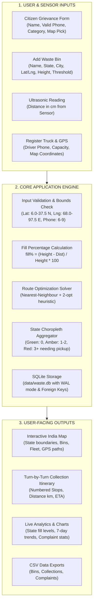
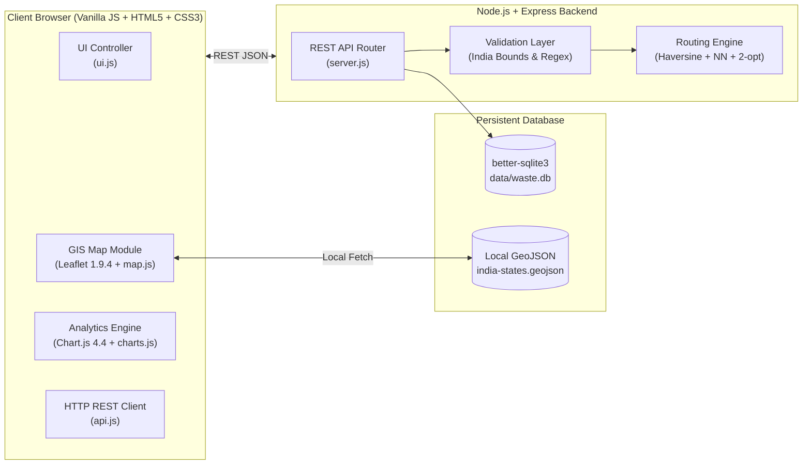

# Smart Waste Collection Tracking System (India)

[](LICENSE)
[](https://nodejs.org/)
[](https://expressjs.com/)
[](https://github.com/WiseLibs/better-sqlite3)
[](https://leafletjs.com/)
[](https://www.chartjs.org/)

An enterprise-grade, interactive Geographic Information System (GIS) and operational logistics dashboard for smart municipal solid waste management across India. The application features real-time ultrasonic bin fill monitoring, automated fleet GPS dispatch, citizen grievance logging, and mathematical route optimization (Nearest-Neighbour + 2-opt geometric pass) mapped over official Survey of India administrative boundaries.

---

## 📌 Project Overview

Urban waste management in India presents unique logistical challenges across metropolitan centers and tier-2/tier-3 cities. The **Smart Waste Collection Tracking System (India)** provides municipal administrators, sanitation officers, and logistics dispatchers with complete situational awareness.

**Key Operating Principle**: The system follows strict operational hygiene. **All data originates from user input or manual field telemetry** (forms and interactive map clicks). No random dummy data, fluctuating simulated timers, or artificial fixtures exist upon startup. The application starts clean and pristine, with an optional one-click *"Load Demo Data"* button for rapid demonstration and testing.

---

## 🌟 Key Features

1. **Interactive India GIS Map**:
   - Leaflet 1.9.4 map pre-fitted to the Republic of India boundaries (`[[6.0, 68.0], [37.5, 97.5]]`) with strict pan constraints.
   - Offline-capable state & UT administrative boundaries loaded locally from `public/data/india-states.geojson` following official Government of India / Survey of India demarcation (including Jammu & Kashmir and Ladakh).
   - Dynamic choropleth color-coding by pickup urgency: **Light Green** (0 full bins), **Amber** (1–2 full bins), and **Red** (3+ full bins requiring immediate collection).
   - Rich hover tooltips and one-click zoom & state panel filtering.
   - Instant local search box with autocomplete to jump to any of the 36 States/UTs or recorded cities without third-party geocoding APIs.
   - Custom SVG garbage truck markers with real-time driver tags and multi-colored bin level markers.

2. **Bin Telemetry & Ultrasonic Fill Calculation**:
   - Bin profile registry (Height in cm, capacity thresholds, geolocation, state, and city).
   - Ultrasonic sensor distance processing:
     $$\text{Fill \%} = \frac{\text{Bin Height} - \text{Sensor Distance}}{\text{Bin Height}} \times 100$$
   - Color-coded marker alerts: **Green** ($<50\%$), **Amber** ($50\%$ to threshold), **Red** ($\ge \text{threshold}$).
   - Historical time-series telemetry log per bin.

3. **Fleet Tracking & GPS Travel Path**:
   - Garbage truck registry with driver credentials, 10-digit Indian mobile validation (`/^[6-9]\d{9}$/`), and load capacity (kg).
   - Manual or map-picked GPS coordinate updates recorded in a persistent `gps_history` table.
   - Interactive historical travel breadcrumbs rendered as dashed polyline trails.

4. **Algorithmic Route Optimization (TSP Solver)**:
   - Identifies all bins at or above their pickup threshold (optionally filtered by state).
   - Constructs a tour using the **Nearest-Neighbour** heuristic with the great-circle **Haversine** distance:
     $$d = 2R \arcsin \left( \sqrt{\sin^2\left(\frac{\Delta \phi}{2}\right) + \cos(\phi_1)\cos(\phi_2)\sin^2\left(\frac{\Delta \lambda}{2}\right)} \right)$$
   - Further optimizes the route using a deterministic **2-opt local search pass** to untangle crossing paths and minimize total transit distance.
   - Displays turn-by-turn stop sequence, total travel distance (km), and estimated travel time (ETA) based on configurable municipal transit speeds (default 25 km/h).

5. **One-Click Pickup Collection**:
   - Field dispatchers can mark stops or bins collected with a single click.
   - Resets fill level to 0%, logs an empty ultrasonic reading, stores an immutable collection record, and updates the active itinerary.

6. **Citizen Grievance Portal**:
   - Public reporting interface validating citizen phone numbers, grievance categories (*Overflow, Missed pickup, Damaged bin, Other*), descriptions, and optional map-pinned locations.
   - Municipal admin triage workflow (*Open*, *In progress*, *Resolved*).

7. **Analytics Dashboard & Reports**:
   - 6 top-line KPI metrics with live state aggregations.
   - 4 Chart.js charts: Bins needing pickup per state, 7-day collection trends, complaint category breakdowns, and average fill levels.
   - Searchable, sortable, and state-filtered data tables.
   - Instant CSV data export for offline municipal auditing.

---

## 🛠️ Tech Stack

- **Runtime & Backend**: Node.js (v18+) with Express.js REST API.
- **Database**: SQLite via `better-sqlite3` (`data/waste.db`, auto-migrated with WAL mode and foreign key constraints).
- **Frontend**: Vanilla JavaScript (ES6+ modular architecture: `api.js`, `map.js`, `charts.js`, `ui.js`, `app.js`), Modern Responsive CSS3 with custom CSS Variables, HTML5. No build tools or bundlers needed.
- **GIS & Mapping**: Leaflet 1.9.4 with OpenStreetMap raster tiles.
- **Data Visualizations**: Chart.js 4.4.2.
- **Geospatial Boundaries**: Survey of India official boundary GeoJSON stored locally in `public/data/india-states.geojson`.

---

## 📸 Screenshots & UI Layout

```
+---------------------------------------------------------------------------------------------------------+
| [♻️ WasteTrack India  [Live GIS]]     [🔍 Search state (e.g. Maharashtra, Ladakh) or city...]  [Demo] [Theme]|
+----------------------------------------------------+----------------------------------------------------+
| SIDEBAR TABS:                                      | INTERACTIVE INDIA GIS MAP                          |
| [📊 Dashboard] [🗑️ Bins] [🚛 Trucks] [⚡ Routes]   |                                                    |
|                                                    |      /\                                            |
| SUMMARY KPI CARDS:                                 |     /  \    [Ladakh]                               |
| [ Total Bins: 6 ]  [ Needs Pickup: 4 ]             |    /    \                                          |
| [ Fleet: 3 ]       [ Grievances: 2 ]               |   /  /\  \   [Delhi: 1 bin]                        |
|                                                    |  |  |  |  |                                        |
| REAL-TIME CHARTS:                                  |  |  \__/  |                                        |
| 1. Bins Needing Pickup by State (Bar)              |  \        /  [Rajasthan]    [West Bengal: 1 bin]   |
| 2. Collections Last 7 Days (Line)                  |   \      /                                         |
| 3. Complaints Breakdown (Doughnut)                 |    |    /   [Maharashtra: 2 bins]                 |
| 4. Average Fill % by State (Bar)                   |    |   |     🚛 MH-02-CW-4921                     |
|                                                    |    |   |                                           |
| TABLES & FORMS:                                    |    \   /    [Karnataka: 1 bin]                    |
| - Add Bin / Ultrasonic Distance Reading            |     \_/                                            |
| - Fleet Registration & GPS Updates                 |      \      [Tamil Nadu: 1 bin]                    |
| - Route Optimization Engine (NN + 2-opt)           |       V                                            |
| - Citizen Complaints Portal & CSV Export           |  [Layer Toggles: States, Bins, Trucks, Routes]     |
+----------------------------------------------------+----------------------------------------------------+
```

---

## 🔄 System Workflow: Input $\rightarrow$ Processing $\rightarrow$ Output



---

## 🏗️ System Architecture



---

## 🚀 Installation & Getting Started

### Prerequisites
- **Node.js**: v18.0.0 or higher
- **npm**: v9.0.0 or higher

### Quick Start (One Command)

```bash
# 1. Clone the repository
git clone https://github.com/<my-username>/smart-waste-collection-tracking-system.git
cd smart-waste-collection-tracking-system

# 2. Install pinned dependencies
npm install

# 3. Start the application
npm start
```

Open your browser and navigate to:
```
http://localhost:3000
```

To run in live-reload development mode:
```bash
npm run dev
```

---

## 📖 How to Use Each Form & Feature

### 1. Add Bin Form
- Navigate to the **🗑️ Bins** tab.
- Enter a unique **Bin ID** (e.g., `BIN-MUM-01`).
- Select the **State / UT** (dropdown auto-populated from Survey of India GeoJSON).
- Enter the **City / Ward** (e.g., `Bandra West, Mumbai`).
- Provide **Latitude** and **Longitude**:
  - Type them directly (e.g., `19.0596`, `72.8295`), OR
  - Click **📍 Pick on Map** and click any location in India on the map.
- Specify **Bin Height** (cm, default 100) and **Pickup Threshold** (%, default 80).
- Click **Add Waste Bin**.

### 2. Update Bin Reading (Ultrasonic Sensor Emulation)
- In the Bins table or from any Bin popup on the map, click **📶 Reading**.
- Enter the ultrasonic sensor distance from the top of the bin to the waste surface in centimeters ($0 \le \text{distance} \le \text{height}$).
- The modal instantly calculates the fill percentage:
  - If a 100 cm bin reads 15 cm, fill level is $85\%$.
- Click **Save Reading**. The bin marker dynamically updates its color:
  - **Green** if fill is under 50%
  - **Amber** if fill is between 50% and 79%
  - **Red** if fill reaches or exceeds 80% (needs pickup).

### 3. Add Garbage Truck
- Navigate to the **🚛 Trucks** tab.
- Enter **Truck Number** (e.g., `MH-02-CW-4921`).
- Enter **Capacity in kg** (e.g., `3500`).
- Enter **Driver Name** (e.g., `Ramesh Patil`) and a valid 10-digit Indian mobile number starting with 6–9 (e.g., `9820112233`).
- Set starting coordinates manually or via **📍 Pick on Map**.
- Click **Register Truck**. A custom garbage truck icon appears on the map.

### 4. Update Truck GPS Location & Traveled Path
- Click **📍 GPS** in the fleet table or truck popup.
- Enter new coordinates or click on the map.
- The location is updated in the fleet registry and stored in `gps_history`.
- Click **🗺️ Path** to render the truck's traveled breadcrumbs as a dashed polyline.

### 5. Plan Route (Nearest-Neighbour + 2-Opt TSP Solver)
- Navigate to the **⚡ Route Planner** tab.
- Select the active **Garbage Truck**.
- Choose a specific **State Filter** or leave as *"All India"*.
- Set the municipal transit speed (default 25 km/h).
- Click **Compute Optimal Route**.
- The server computes the visiting sequence, renders a numbered itinerary, and draws the blue collection route on the map with numbered stop pins.

### 6. Mark Bin Collected
- Click **✓ Collect** on any stop in the planned route or in a bin popup.
- The bin fill is automatically reset to 0%, an empty ultrasonic reading is logged, a collection entry is created, and the active route is updated.

### 7. Citizen Complaint Form
- Navigate to the **📢 Complaints** tab.
- Enter citizen name, valid 10-digit phone number, state, city, category (*Overflow, Missed pickup, Damaged bin, Other*), and issue description.
- Coordinates can optionally be picked on the map.
- Administrators can update complaint status directly (*Open*, *In progress*, *Resolved*).

### 8. CSV Reports & Utilities
- Navigate to the **📁 Reports** tab.
- Click any download button to export Bins, Collections, or Complaints as CSV.
- Click **✨ Load Demo Data** to populate realistic sample data across Mumbai, Delhi, Bengaluru, Chennai, and Kolkata.
- Click **⚠️ Reset Database** to wipe data back to a clean state.

---

## 📡 REST API Reference

| Method | Endpoint | Description |
|---|---|---|
| `GET` | `/api/bins` | Retrieve all bins (optional `?state=` and `?needing_pickup=true`) |
| `POST` | `/api/bins` | Create a new bin with Indian coordinate validation |
| `GET` | `/api/bins/:id` | Get details for a specific bin |
| `PUT` | `/api/bins/:id` | Update bin parameters |
| `DELETE` | `/api/bins/:id` | Delete a bin and its readings |
| `POST` | `/api/bins/:id/readings` | Submit ultrasonic distance reading and update fill % |
| `GET` | `/api/bins/:id/readings` | Retrieve historical telemetry readings for a bin |
| `GET` | `/api/trucks` | List all registered garbage trucks |
| `POST` | `/api/trucks` | Register a new truck with driver credentials |
| `GET` | `/api/trucks/:id` | Get single truck details |
| `PUT` | `/api/trucks/:id` | Update truck details |
| `DELETE` | `/api/trucks/:id` | Delete a truck |
| `POST` | `/api/trucks/:id/location` | Log new GPS coordinates and append to GPS history |
| `GET` | `/api/trucks/:id/history` | Retrieve full GPS history breadcrumbs for a truck |
| `POST` | `/api/routes/plan` | Calculate optimal collection route (NN + 2-opt) |
| `GET` | `/api/routes/latest/:truck_id` | Get latest computed route for a truck |
| `POST` | `/api/collections` | Mark bin collected (resets fill to 0%, logs record) |
| `GET` | `/api/collections` | Retrieve pickup collection history |
| `GET` | `/api/complaints` | Retrieve citizen complaints (filter by state/status) |
| `POST` | `/api/complaints` | Submit citizen complaint |
| `PUT` | `/api/complaints/:id` | Update complaint status or details |
| `DELETE` | `/api/complaints/:id` | Delete complaint record |
| `GET` | `/api/stats` | Summary KPIs and pre-computed Chart.js aggregations |
| `GET` | `/api/export/:type` | Download CSV for `bins`, `collections`, or `complaints` |
| `POST` | `/api/demo-data` | Seed sample Indian bins, fleet, and complaints |
| `POST` | `/api/reset` | Clear all tables to a clean state |
| `GET` | `/api/health` | Service uptime and health monitor |

---

## 📂 Project Folder Structure

```
smart-waste-collection-tracking-system/
├── data/
│   ├── .gitkeep                      # Git placeholder (database is ignored)
│   └── waste.db                      # Auto-created SQLite database (in .gitignore)
├── public/
│   ├── css/
│   │   └── style.css                 # Modern CSS design system with Dark Mode
│   ├── data/
│   │   └── india-states.geojson      # Survey of India official boundary GeoJSON
│   ├── js/
│   │   ├── api.js                    # Fetch wrapper, toasts, button lock, XSS protection
│   │   ├── map.js                    # Leaflet map, choropleth, markers, route polylines
│   │   ├── charts.js                 # Chart.js instances and responsive theme updates
│   │   ├── ui.js                     # Tab navigation, modal controllers, table sort/search
│   │   └── app.js                    # Core event orchestrator and form handlers
│   └── index.html                    # Responsive single-page application interface
├── .env.example                      # Environment variables template
├── .gitignore                        # Git exclusion rules (node_modules, data/*.db, .env)
├── db.js                             # better-sqlite3 schema definitions and connection
├── LICENSE                           # MIT License
├── package.json                      # Pinned production dependencies and npm scripts
├── package-lock.json                 # Locked dependency tree
├── README.md                         # Project documentation
└── server.js                         # Express server, REST endpoints, TSP solver
```

---

## 🔮 Future Scope & Production Roadmap

1. **IoT Hardware Integration (ESP32 + Ultrasonic + GPS)**:
   - Integrate ESP32 microcontrollers with HC-SR04 ultrasonic sensors installed on municipal bin lids to broadcast HTTP/MQTT telemetry directly to `/api/bins/:id/readings`.
   - Mount NEO-6M GPS modules on garbage trucks to stream live coordinates to `/api/trucks/:id/location` every 15 seconds.

2. **Cross-Platform Mobile App (Flutter / React Native)**:
   - Native mobile client for sanitation drivers providing turn-by-turn voice navigation along the optimized 2-opt route.
   - Citizen camera app with automatic geo-tagging to submit photo-verified complaints.

3. **Machine Learning Fill Rate Prediction**:
   - Time-series forecasting (ARIMA / LSTM) analyzing historical fill rates against seasonal events, holidays, and weather data to predict bin overflow 24 hours in advance.

4. **Multi-Depot Capacitated Vehicle Routing Problem (CVRP)**:
   - Scale routing engine to support fleet capacity bounds ($Q_{\text{max}}$) with dump depot drop-offs when trucks reach full capacity.

---

## 🚀 Pushing to GitHub

To publish this project to your GitHub account:

```bash
# 1. Initialize git repository (if not already initialized)
git init

# 2. Stage all files
git add .

# 3. Create initial commit
git commit -m "Initial commit: Smart Waste Collection Tracking System (India)"

# 4. Add your GitHub remote repository
git remote add origin https://github.com/<my-username>/<repo-name>.git

# 5. Set default branch to main and push
git branch -M main
git push -u origin main
```

---

## 📄 License

This project is licensed under the [MIT License](LICENSE).
